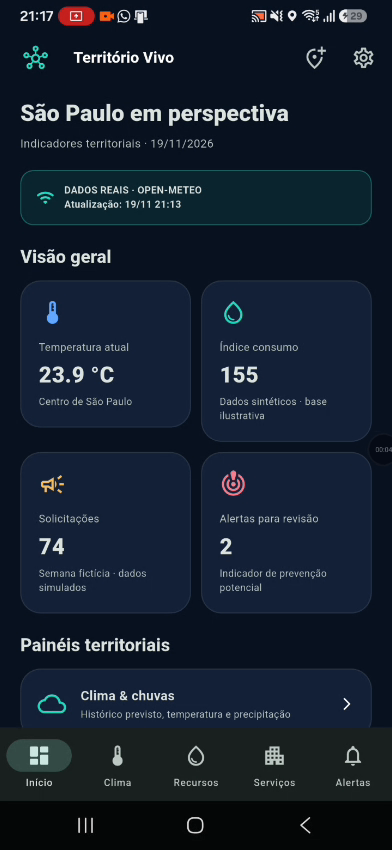
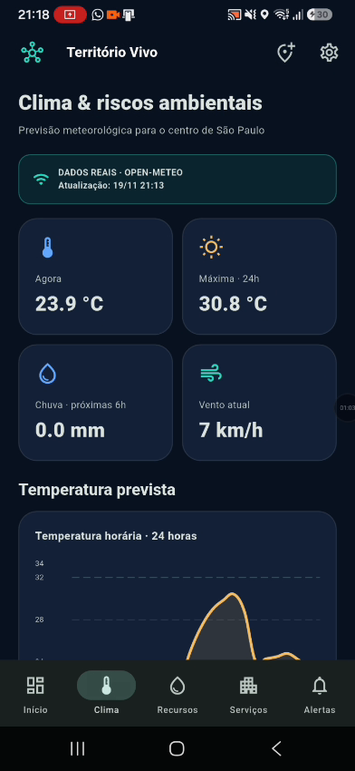
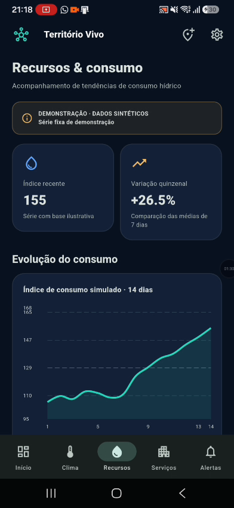
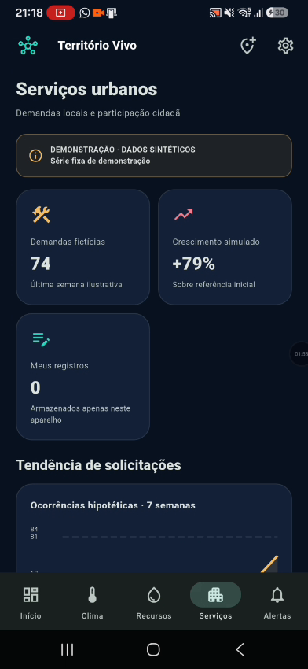
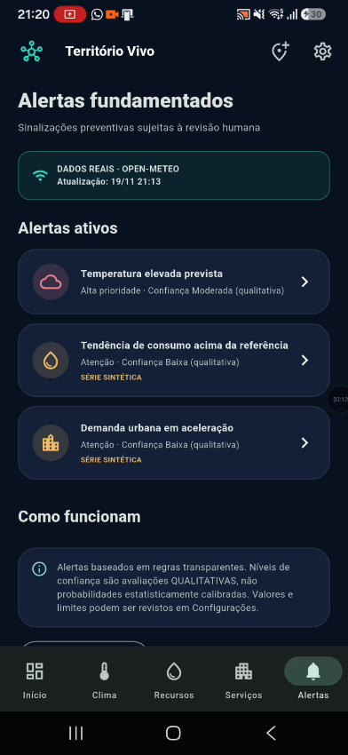
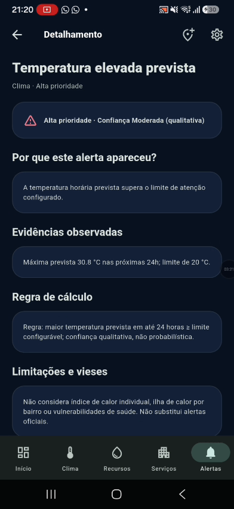
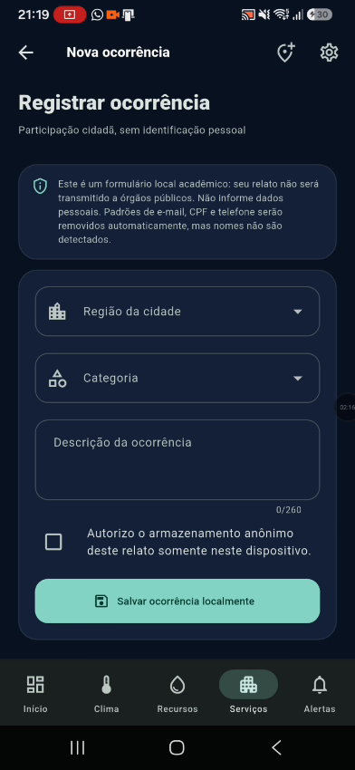
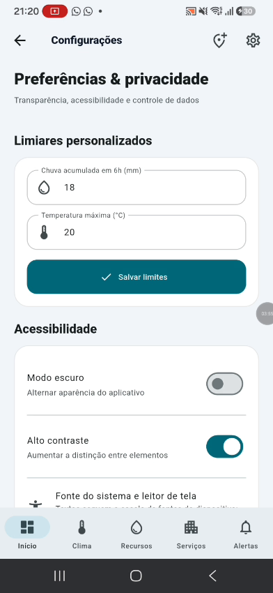

# 1. Território Vivo — Urban Intelligence & Monitoring

> Flutter · Explainable alerts, offline functionality, automated builds and tests · FIAP team project.


**Território Vivo** é um aplicativo Flutter de apoio à leitura de indicadores urbanos e ambientais. Reúne **três dashboards**, **alertas explicáveis**, **registros de ocorrências no próprio dispositivo** e **funcionamento offline**. Nenhum alerta autoriza decisões automáticas de alto impacto.

> **FIAP — Global Solution 2026.2 · Cross-Platform Application Development · CitizenTech / Territory Predictive Insights**
>
> **Build verificado:** [](https://github.com/GuilhermeCalifoni-code/territorio-vivo-gs2026/actions/workflows/flutter.yml) — `flutter analyze` sem erros, 14 testes aprovados e APK de release gerado automaticamente a cada push.
>
> **Baixar o APK:** [Releases](https://github.com/GuilhermeCalifoni-code/territorio-vivo-gs2026/releases/latest) · testado em Android físico.

## 2. Problema, público e impacto social

Territórios urbanos enfrentam riscos meteorológicos, uso ineficiente de recursos e filas por serviços. Informações em sistemas desconectados podem tornar as análises preventivas mais difíceis. O aplicativo reúne sinais interpretáveis para **gestores municipais, equipes técnicas e cidadãos**, inicialmente para **São Paulo**.

A ideia de benefício social é **tornar visíveis tendências antes de possíveis agravos**. O indicador `Alertas para revisão` mede **quantas sinalizações preventivas o aplicativo oferece para avaliação humana**, um *indicador de processo/proxy*, e **não** eventos evitados, vidas salvas ou benefício causal demonstrado. Não existe integração operacional com a Prefeitura.

## 3. Integrantes

| Integrante | RM |
|---|---:|
| Bento Donato Garcia | 561621 |
| Enzo Ribeiro Domingues Piazentin | 564216 |
| Guilherme Domingues Califoni | 565157 |

## 4. Demonstração visual

Capturas do app rodando em Android físico, em `assets/screenshots/`.

| Tela | Arquivo | Função |
|---|---|---|
| Consentimento | `assets/screenshots/01-consentimento.png` | Privacidade explícita |
| Início | `assets/screenshots/02-inicio.png` | Panorama e impacto social |
| Clima | `assets/screenshots/03-clima.png` | Dashboard 1 + gráficos |
| Recursos | `assets/screenshots/04-recursos.png` | Dashboard 2 + série |
| Serviços | `assets/screenshots/05-servicos.png` | Dashboard 3 + ocorrências |
| Alertas | `assets/screenshots/06-alertas.png` | Prioridade e confiança |
| Detalhe do alerta | `assets/screenshots/07-detalhe-alerta.png` | Evidências/limitações |
| Detalhe do indicador | `assets/screenshots/08-detalhe-indicador.png` | Fórmula e fonte |
| Formulário de ocorrência | `assets/screenshots/09-formulario.png` | Validações e consentimento |
| Configurações | `assets/screenshots/10-configuracoes.png` | Limiares, UX e exclusão |

<!-- SCREENSHOT_GALLERY_START -->
| | |
|---|---|
|  |  |
| **Início** | **Clima** |
|  |  |
| **Recursos** | **Serviços** |
|  |  |
| **Alertas** | **Detalhe do alerta** |
|  |  |
| **Formulário** | **Configurações** |
<!-- SCREENSHOT_GALLERY_END -->

## 5. Funcionalidades implementadas no código

- [x] 10 telas/estados de navegação com GoRouter, **rotas nomeadas** e parâmetros.
- [x] Três dashboards distintos com indicadores, gráficos e tendências.
- [x] Alertas por regras matemáticas, evidência, confiança qualitativa, limites e transparência.
- [x] Supervisão humana explícita nos painéis e alertas.
- [x] Estado global reativo com Riverpod, compartilhado entre telas.
- [x] Tratamento de carregamento, erro de rede e lista vazia de relatos.
- [x] Consumo de API Open-Meteo e fallback para cache local ou dados sintéticos.
- [x] Persistência das preferências, limiares, consentimento e ocorrências.
- [x] Formulário com validação, mensagens e confirmação.
- [x] Indicador proxy de prevenção exibido no dashboard inicial.
- [x] Modo escuro, modo claro, alto contraste, labels de acessibilidade e escala de fonte do sistema.
- [x] Testes unitários da lógica de alertas, parsing da API e persistência, e testes de widget de navegação e consentimento.
- [x] Testes executados e aprovados no SDK Flutter (GitHub Actions).
- [ ] Verificação manual de layouts em duas resoluções.
- [x] APK de release compilado, publicado em Releases e instalado em Android físico.
- [x] Capturas reais das telas e vídeo público.

## 6. Dados, alertas, métricas, vieses e limitações

### Fontes e proveniência

**Clima:** [Open-Meteo Forecast API](https://open-meteo.com/en/docs), chamada HTTPS sem chave, com lat=-23.5505, lon=-46.6333, timezone=`America/Sao_Paulo`, variáveis atuais (`temperature_2m`, `relative_humidity_2m`, `precipitation`, `wind_speed_10m`) e horárias (`temperature_2m`, `precipitation`, `precipitation_probability`, `relative_humidity_2m`). **Não** há estação local exclusiva nem granularidade de bairros. O API fornece *previsões*, não medições locais garantidas.

**Recursos hídricos:** 14 valores de **índice de consumo inteiramente sintético**, presentes em `lib/models/territory_models.dart`, para demonstrar tendência. Não são litros, m³ ou dados da SABESP.

**Serviços:** 7 valores semanais **100% sintéticos**. Não são chamados do SP156 e não devem ser interpretados como demanda real. Relatos enviados pelo cidadão ficam **somente no aparelho** e não alimentam a série de demonstração nem entram em sistemas públicos.

**Offline:** o cache da última previsão bem-sucedida, quando existe, é mostrado com etiqueta **CACHE**. Sem cache ou internet, aparece cenário **DEMONSTRAÇÃO / DADOS SINTÉTICOS**, gerado localmente. A origem é sempre visível em cada painel.

### Regras dos alertas

| Categoria | Gatilho | Evidência apresentada | Limitações |
|---|---|---|---|
| Chuva | Somar precipitação prevista nas próximas **6 horas**; alerta se `soma >= limite mm` (inicial 18 mm) | mm acumulados, pico de probabilidade meteorológica, limite do usuário | Não estima alagamento; não usa drenagem, topografia ou medições por rua |
| Calor | Máxima prevista nas próximas **24 horas** `>= limite °C` (inicial 33 °C) | Máxima e limite | Não estima risco individual à saúde ou ilha de calor por bairro |
| Água | `(média da 2ª semana / média da 1ª semana - 1) * 100 > 15%` | Variação entre índices sintéticos | Não prova desperdício real |
| Serviços | `(última semana / média das primeiras 3 semanas - 1) * 100 > 40%` | Tendência sintética relativa | Sem representatividade estatística da população |

**Confiança:** rótulos de `baixa`, `moderada` ou `alta`, sempre **qualitativos**. Não são probabilidades de acerto validadas. Alertas gerados com dados sintéticos ou cache meteorológico com mais de 6 horas têm **baixa** confiança. Mesmo com dados meteorológicos reais, a chuva prevista **não equivale** à probabilidade de inundação.

**Quando não confiar:** falta de conexão sem dados recentes, ausência de histórico suficiente, chuva convectiva muito localizada, falhas de infraestrutura de coleta, séries fictícias, eventos extremos fora da amostra e mudanças abruptas do território. O app apresenta limites e fontes. Nenhuma decisão de alto impacto é automática.

### Viés e equidade

Dados de clima pontuais não representam todas as regiões de São Paulo; bairros com menos sensores podem ter sub-representação. Relatos voluntários podem sofrer viés de participação e acesso digital. Por isso o MVP **não cria ranking de bairros nem alocação automática de recursos**. Há previsão de expansão com base geoespacial confiável, governança de dados e validação de órgãos competentes.

## 7. Privacidade e inclusão

- Consentimento explícito na primeira abertura; sem consentimento não há solicitação da API pelo app.
- Sem autenticação, GPS, contatos, permissões de localização, câmera ou solicitação de nome, CPF ou endereço exato.
- Formulário coleta **região ampla**, categoria e descrição livre; orientação para não incluir dados identificáveis. **O app remove padrões estruturados de e-mail, CPF e telefone antes do armazenamento; texto livre ainda pode conter dados pessoais, por isso não alegamos anonimização garantida.**
- Dados ficam no armazenamento simples do dispositivo com `SharedPreferences`, **não criptografado**; portanto **não utilizar para informações sensíveis**.
- Revogação de consentimento e limpeza de cache/ocorrências nas Configurações.
- Sem analytics comportamental nem upload de ocorrências.
- Descrições semânticas para botões e gráficos; interfaces seguem o dimensionamento de fonte do sistema; modo claro/escuro e alto contraste.
- Necessário validar manualmente TalkBack, font scaling alto e dois formatos de tela antes da entrega.

## 8. Tecnologias, arquitetura e decisões técnicas

| Escolha | Motivação |
|---|---|
| **Flutter / Dart** | Plataforma obrigatória e UI nativa multiplataforma |
| **GoRouter** | Rotas nomeadas, caminhos e parâmetros explícitos |
| **Riverpod 2** | Estado global imutável e testável, separado do estado local de formulários |
| **HTTP** | Consulta REST simples via HTTPS à Open-Meteo |
| **SharedPreferences** | Cache e preferências de baixo risco disponíveis offline |
| **fl_chart** | Gráficos temporais interativos acessíveis com sumário semântico |
| **Material Design 3** | Componentes reutilizáveis, temas e responsividade |
| **Testes Flutter** | Motor de alertas, origem, API, persistência e widget |

Estrutura modular:

```text
lib/
  core/           # regras de alerta, tema
  data/           # API Open-Meteo, estado Riverpod e persistência
  models/         # domínio, fontes e cenários sintéticos
  widgets/        # cards, gráficos, acessibilidade, banners
  features/
    consent/ overview/ dashboards/ alerts/
    indicators/ report/ settings/
test/             # testes automatizados
android/          # código nativo + configuração Gradle
assets/screenshots/ # capturas do app rodando
scripts/          # inicialização Android e conferência de entrega
```

### Decisão de modelagem

O projeto é **preditivo por regras sobre previsões meteorológicas**, abordagem permitida pela rubrica que aceita “regras ou previsões”; não treinamos machine learning nem fingimos dispor de métricas de validação. Para uso em produção, seriam necessários dados oficiais de recursos/serviços, calibração, métricas de falso positivo/falso negativo e avaliação social.

## 9. Como executar e testar

Recomendação: **Flutter estável 3.50 ou posterior (Dart 3.12+)**, JDK 17, Android SDK instalado e telefone/emulador Android com API 24+.

Documentação de instalação: https://docs.flutter.dev/install

```powershell
# 1. Abrir a pasta extraída no PowerShell / terminal
cd territorio_vivo

# 2. Conferir o ambiente
flutter doctor -v

# 3. Gerar arquivos binários padrão do wrapper Gradle ausentes neste ZIP
powershell -ExecutionPolicy Bypass -File .\scripts\preparar_android.ps1

# 4. Executar app
flutter devices
flutter run

# 5. Gerar APK (release com assinatura de DEBUG, somente demonstração)
flutter build apk --release
# Saída esperada: build/app/outputs/flutter-apk/app-release.apk
```

Para Linux/macOS: `bash scripts/preparar_android.sh`. O script cria scaffold Android temporário para obter **gradle-wrapper.jar, gradlew e gradlew.bat** sem alterar arquivos Dart do projeto. Depois executa `flutter pub get`, `flutter analyze` e `flutter test`.

Se um conflito de Gradle/AGP ocorrer após atualização de SDK, gere um projeto Flutter 3.50 novo e compare as versões do wrapper e dos plugins. Não há credenciais a configurar. Para executar sem internet, abra o app e aceite o consentimento — o estado de rede mostrará os dados sintéticos, com explicação explícita.

### Passo a passo de qualidade antes de enviar

1. `flutter analyze` sem erros.
2. `flutter test` com todos os casos aprovados.
3. `flutter run` em um Android e validar telas, scroll, voltar, botões, erros, exclusão e atualização.
4. Testar em duas telas (por exemplo, 360×800 e 412×915) e com fonte 150%.
5. Iniciar com internet, depois desligar a rede e conferir **CACHE** / **DEMONSTRAÇÃO**.
6. Nas Configurações, mudar chuva de 18 para 200 e calor de 33 para 50; comprovar recálculo e persistência após reiniciar.
7. Registrar ocorrência e validar persistência local; depois limpar os registros.
8. Capturar todas as telas, executar `python scripts/finalizar_readme.py` e conferir as imagens no GitHub.
9. Gravar vídeo de até 3 minutos e publicar com acesso público.
10. Construir APK, instalar e abrir. Publicar opcionalmente na área `Releases` do GitHub.

## 10. Vídeo de demonstração

**Link público: PENDENTE DE GRAVAÇÃO** — use o roteiro em [`docs/ROTEIRO_VIDEO.md`](docs/ROTEIRO_VIDEO.md). Grave o app real; vídeos genéricos ou slides **não cumprem o requisito**. Limite máximo: **3 minutos**, com narração ou legendas, mostrando alertas e evidências.

## 11. Licença

Projeto acadêmico desenvolvido para **FIAP · Global Solution 2026.2**, disciplina **Cross-Platform Application Development**, desafio **Territory Predictive Insights**, tema **CitizenTech**. Material de demonstração educacional, sem homologação para uso operacional em serviços públicos. Sem autorização para uso como sistema de segurança civil.

Fontes externas sujeitas aos próprios termos, incluindo a atribuição à **Open-Meteo**: https://open-meteo.com/en/terms.
